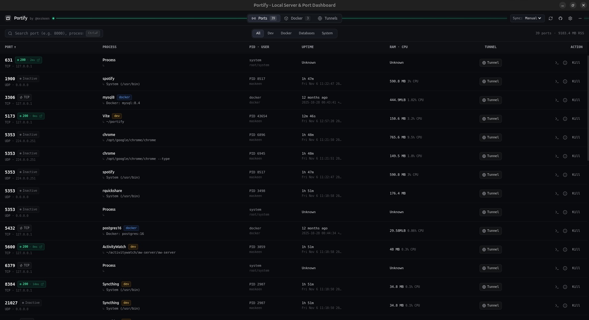

<div align="center">


# Portify

**Local Server, Port & Docker Dashboard for Developers**

</div>

---

Portify eliminates the friction of port collisions, runaway background processes, and fragmented terminal utilities (`lsof`, `fuser`, `netstat`, `docker ps`). 

It provides developers with a single, real-time control plane to inspect everything listening on localhost, diagnose hung servers, view live logs, and expose services to the internet with a single click.

---

## Preview

<!-- Add your application screenshot below. Replace the path with your screenshot image. -->



---

## Installation

### Linux & macOS (1-Command Install)

```bash
curl -fsSL https://raw.githubusercontent.com/mxskeen/portify/main/install.sh | bash
```

### Windows

Run in PowerShell:
```powershell
irm https://raw.githubusercontent.com/mxskeen/portify/main/install.ps1 | iex
```
Or download the installer executable directly from [GitHub Releases](https://github.com/mxskeen/portify/releases/latest).

---

## Core Capabilities

- **Port & Process Introspection**: Identifies the exact process, user, PID, memory usage, CPU load, uptime, working directory, and command line bound to every listening port.
- **Live HTTP Health & Latency Pinging**: Continuously verifies application-layer responsiveness, showing HTTP status codes (200, 404, 500), round-trip latency in milliseconds, and frozen/hung server warnings. Click any badge to open directly in your default browser.
- **Embedded Real-Time Server Logs**: Integrated terminal console that streams live logs directly from Docker containers, systemd services, standard output/error file redirects, and application log files with ANSI syntax coloring and real-time keyword filtering.
- **Instant Cloudflare Public Tunnels**: Expose any local listening port to a secure public HTTPS URL (`trycloudflare.com`) without account configuration or firewall adjustments.
- **Docker Container Management**: Inspect all running and stopped containers, live CPU and memory metrics, mapped host ports, and execute stop, restart, or force-kill commands.
- **Process Termination**: Terminate unresponsive processes cleanly, with elevated authentication prompts for root-owned and system services.
- **In-App Background Updates**: Automatically checks for new releases, downloads updates in the background, and prompts to restart and apply with one click.
- **System Tray Integration**: Operates quietly in the background with quick tray statistics and optional system autostart.

---

## Keyboard Shortcuts

| Shortcut | Description |
| :--- | :--- |
| `Ctrl` / `Cmd` + `R` | Trigger an immediate port and container scan |
| `Ctrl` / `Cmd` + `F` | Open the spotlight search modal |
| `Esc` | Dismiss any open modal, inspector, or log stream |

---

## Development

```bash
# Clone and install
git clone https://github.com/mxskeen/portify.git
cd portify
npm install

# Run development server
npm run dev

# Build production bundle
npm run build

# Package desktop installer
npm run dist
```

---

## License

Distributed under the [MIT License](LICENSE).
